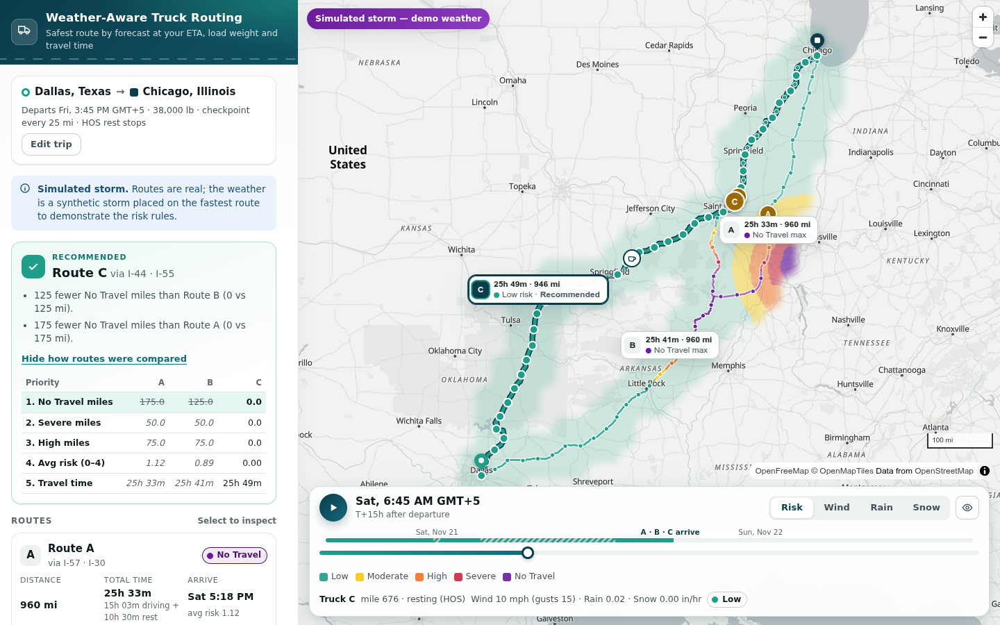
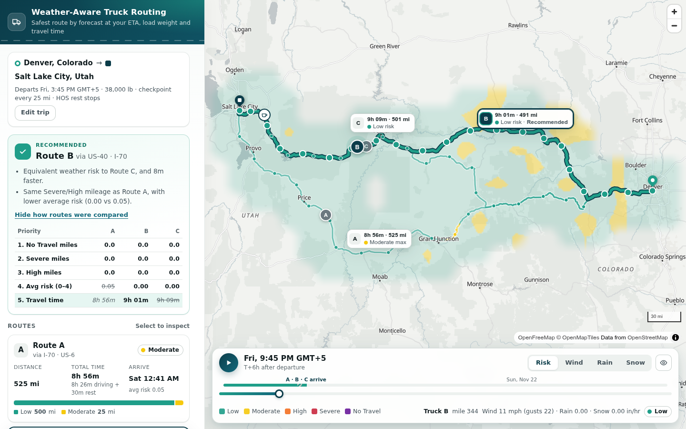
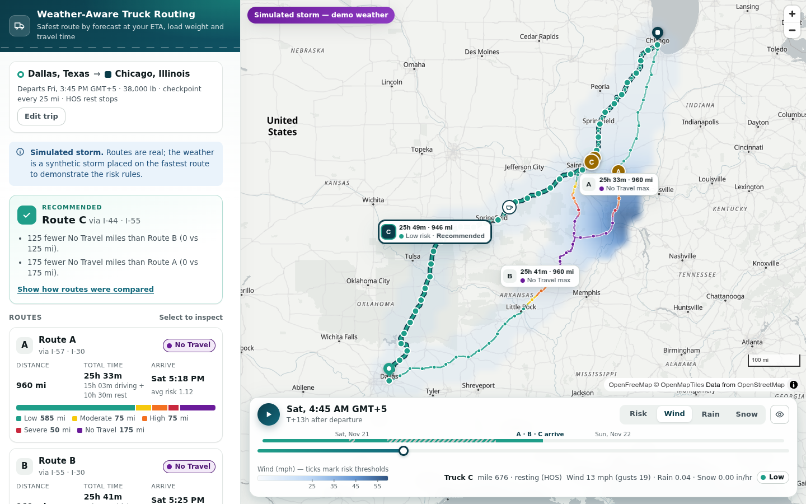
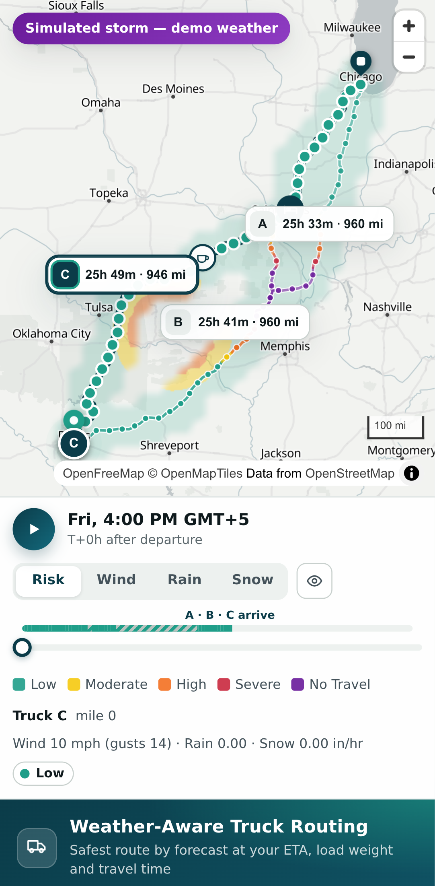

# Weather-Aware Truck Routing

A React + Django app that helps a truck driver pick the safest route by **weather at the
time the truck will actually be there**, **load weight** and **travel time**.

> **Live demo:** _add the Render URL after deploying (see [Deploy](#deploy))_ ·
> **Walkthrough video:** _add the Loom link_



| Live forecast (Denver → Salt Lake City) | Wind layer at T+13h | Phone |
|---|---|---|
|  |  |  |

## Requirements → implementation

| Brief | How it's done |
|---|---|
| Origin, destination, departure time, load weight | Autocomplete (Photon/OSM), local date-time picker, weight input + slider marked at the 30k / 40k lb rule limits; validated client- and server-side |
| 3 route options from a routing API | Valhalla **truck** costing (gross weight, 65 mph governor). Near-duplicates are dropped and detours synthesised so there are always 3 distinct options where the road network allows; OSRM fallback when Valhalla can't serve a trip |
| Weather every 10 / 25 / 50 mi at the truck's ETA | Checkpoints every N miles; ETAs from per-maneuver timing **plus FMCSA rest stops** (30 min after 8 h, 10 h after 11 h); Open-Meteo hourly forecast read at each ETA with the right semantics (wind interpolated, precipitation from the hour bucket) |
| Risk rules + load rules | Encoded as data, served to the browser, identical classifier in Python and TypeScript, both verified against the same 45 golden cases (`shared/risk_vectors.json`) |
| Recommend balancing risk and time | Strict priority order: fewest Severe miles → fewest High miles → lowest average risk → shortest time (No Travel miles checked first). The UI shows the full comparison table and a reason for each losing route |
| Routes, checkpoints, risk levels, ETAs, summaries on a map | MapLibre GL: risk-coloured route segments, checkpoint dots with hover/click popups (ETA, wind/gust, rain, snow, drivers, load-rule flag), on-map route summary chips, rest-stop markers |
| Weather heatmap along the corridor with a 0–48 h slider | Corridor-shaped weather lattice (48 h of hourly frames), rendered as a smooth raster that is classified with the real risk rules per pixel; Risk / Wind / Rain / Snow layers; slider + playback with trucks moving along each route |

## Try it

1. Pick an example trip (e.g. **Dallas → Chicago**) and press **Find safest route**.
2. On a calm day, open **Options → Simulated storm**: routes stay real, but a moving storm is
   placed on the fastest route so every risk level and the load rules are visible.
3. Drag the timeline or press **Play**: the heatmap, truck markers and the conditions readout
   follow the clock. Click a checkpoint row or dot for details; **Show how routes were
   compared** explains the recommendation.

## Run it

**Docker (production build, one container):**

```bash
docker compose up --build        # http://localhost:8080
```

**Local development:**

```bash
make setup                       # Python venv + npm install
make dev-api                     # Django on :8010 (real providers)
make dev-web                     # Vite on :5173, proxies /api -> :8010
```

Offline mode (no third-party calls; used by the e2e tests): set `ROUTING_PROVIDER=simulated`,
`ROUTING_FALLBACK=`, `WEATHER_PROVIDER=simulated`, `GEOCODER=gazetteer`.

## How it works

```
POST /api/plan
  Valhalla truck routes (best + alternates) ──► dedupe / synthesise to 3 distinct routes
  per route: checkpoints every N mi ──► driving time + HOS rest ──► ETA at each checkpoint
  one batched Open-Meteo request for every checkpoint (snapped, deduped, cached)
  forecast at each ETA ──► risk level (wind+load, rain, snow) ──► miles per level, avg risk
  ranking: No Travel mi → Severe mi → High mi → avg risk → travel time

POST /api/heatmap   (fired as soon as the plan renders)
  regular lat/lon lattice clipped to the route corridor ──► 49–50 hourly frames of wind,
  gust, rain, snow ──► browser interpolates + classifies per pixel on every slider move
```

The full design, including every decision and its reasoning, is in
**[docs/ARCHITECTURE.md](docs/ARCHITECTURE.md)**. Highlights:

- **Boundaries are explicit:** lower bounds inclusive (35.0 mph is High); the brief's `> 1.00`
  rain / `> 3.0` snow No Travel cells are exclusive; values are classified at the precision
  they're displayed.
- **Mileage is interval-independent:** each checkpoint covers the road halfway to its
  neighbours, so "Severe miles" means the same at 10, 25 or 50-mile sampling.
- **Rest stops change the weather you meet:** on a 960-mile run the 10-hour rest shifts every
  later ETA by 10 hours; ignoring it would sample the wrong hours.
- **The heatmap is a field, not a density plot:** weather values are interpolated and then
  classified, so risk zones have crisp edges exactly where thresholds are crossed. Risk lookups
  use exact precomputed tables; a frame renders in about 4–7 ms.
- **Colour is accessible:** the risk palette was checked for colour-vision deficiency
  (worst ΔE 10.8) and always appears with a text label.

## API

| Endpoint | Purpose |
|---|---|
| `POST /api/plan` | Routes, checkpoints, ETAs, conditions, risk, rest stops, recommendation + decision trail |
| `POST /api/heatmap` | Corridor lattice + hourly frames (wind, gust, rain, snow) for 0–48 h |
| `GET /api/geocode?q=` | Place search for the autocomplete |
| `GET /api/rules` | The risk and load rules as data |
| `GET /api/health` | Health check |

```bash
curl -s -X POST localhost:8080/api/plan -H 'Content-Type: application/json' -d '{
  "origin": {"lat": 32.7767, "lon": -96.797, "label": "Dallas"},
  "destination": {"lat": 41.8781, "lon": -87.6298, "label": "Chicago"},
  "departure_time": "2026-11-21T14:00:00Z",
  "load_weight_lb": 42000, "interval_miles": 25,
  "hos_breaks": true, "wind_basis": "sustained", "weather_source": "live"
}'
```

Errors share one envelope, `{"error": {"code", "message", "fields?"}}`. The codes are
`invalid_request`, `no_route`, `forecast_out_of_range`, `upstream_unavailable` and
`upstream_rate_limited`.

## Tests & quality

| Suite | Count | Notes |
|---|---|---|
| Backend (pytest) | 238 | domain, providers on recorded real responses, use cases, API contract; 99% branch coverage |
| Backend live smoke | 2 | `pytest -m live`, real Valhalla / Open-Meteo / Photon |
| Frontend (Vitest + Testing Library) | 137 | classifier parity, raster, sampling, geometry, store, full UI flows; 97% line coverage |
| End-to-end (Playwright, real Chrome + WebGL) | 9 | map, popups, trucks, playback budget, axe accessibility, phone layout |

```bash
make lint     # ruff, ruff format, mypy --strict | eslint, prettier, tsc
make test     # pytest --cov, vitest --coverage
make e2e      # builds the SPA, runs Django with offline providers, Playwright
```

CI (`.github/workflows/ci.yml`) runs all of the above, then builds the Docker image and
smoke-tests it.

## Deploy

The repo is a Render Blueprint (`render.yaml`): a single Docker web service where Django serves
both the API and the built React app.

1. Push to GitHub, then in Render: **New → Blueprint** → select the repository.
2. Render generates `DJANGO_SECRET_KEY` and picks up the health check (`/api/health`).

| Variable | Default | Purpose |
|---|---|---|
| `DJANGO_SECRET_KEY` | required | generated by Render |
| `DJANGO_ALLOWED_HOSTS` | localhost | Render's hostname is added automatically |
| `OPEN_METEO_API_KEY` | – | optional commercial key (higher limits) |
| `TRUCK_TARE_LB` / `TRUCK_MAX_SPEED_MPH` | 35000 / 65 | truck assumptions |
| `ROUTING_PROVIDER` / `WEATHER_PROVIDER` / `GEOCODER` | valhalla / open-meteo / photon | `simulated` / `gazetteer` for offline |

Any Docker host works the same way (`docker build . && docker run -p 8000:8000 -e DJANGO_SECRET_KEY=…`).

## Project layout

```
backend/
  planner/domain/      pure logic: geometry, checkpoints, HOS, risk rules, ranking, corridor grid
  planner/services/    providers (Valhalla, OSRM, Open-Meteo, Photon, simulated) + use cases
  planner/api/         DRF views, validation, response presenters, error envelope
frontend/
  src/lib/             classifier, sampling, heatmap raster, route geometry, formatting
  src/map/             MapLibre controller and popup/marker markup
  src/components/      form, recommendation, route cards, checkpoint table, timeline
  e2e/                 Playwright specs
shared/                golden test vectors used by both test suites
docs/                  architecture notes, walkthrough script, screenshots
```

## Limitations

- Free public services: Valhalla's demo server caps trips at 1,500 km straight-line (longer
  trips fall back to OSRM's car network with a truck speed cap, with a notice) and asks for
  1 request/second. Production would self-host Valhalla or use a commercial truck API.
- The HOS model assumes a fresh driver and ignores weekly limits, fueling and dock time.
- No live traffic. The forecast is hourly, and visibility and road-surface conditions aren't
  rated because the brief doesn't define rules for them.
