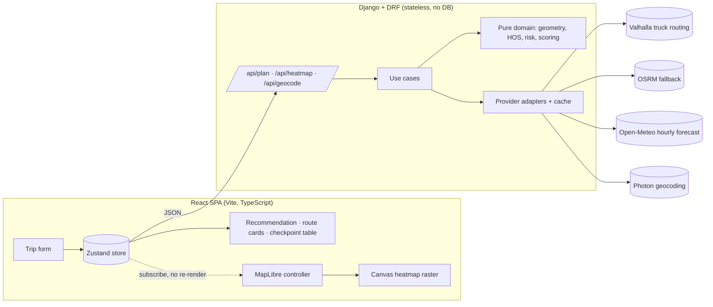

# Architecture & design decisions

This document explains *how* the app works and *why* each non-obvious choice was made. The
README has the quick tour; this is the reference for reviewers who want the details.

- [1. System overview](#1-system-overview)
- [2. Planning pipeline](#2-planning-pipeline)
- [3. Risk rules — exact semantics](#3-risk-rules--exact-semantics)
- [4. Checkpoints, ETAs and rest stops](#4-checkpoints-etas-and-rest-stops)
- [5. Reading the forecast at the ETA](#5-reading-the-forecast-at-the-eta)
- [6. Route recommendation](#6-route-recommendation)
- [7. Three route options, always](#7-three-route-options-always)
- [8. The corridor heatmap](#8-the-corridor-heatmap)
- [9. Frontend performance](#9-frontend-performance)
- [10. Reliability, limits and errors](#10-reliability-limits-and-errors)
- [11. Testing strategy](#11-testing-strategy)
- [12. Known limitations](#12-known-limitations)

---

## 1. System overview

**Layers (backend).** `planner/domain` is pure Python with no I/O and no Django imports:
geometry, checkpoint placement, HOS, risk rules, scoring, the corridor grid. It is 100%
unit-tested and type-checked with `mypy --strict`. `planner/services` holds the provider
adapters (each behind a small `Protocol`) and the two use cases (`plan_trip`, `build_heatmap`).
`planner/api` is thin: validate → call a use case → present JSON.

**Stateless by design.** The API has no database. Routes and forecasts are cached in Django's
cache (LocMem by default) purely as an optimisation; any instance can serve any request, so the
app scales horizontally and restarts are harmless.

**One deployable.** Django serves the API and, through WhiteNoise, the built React app
(content-hashed assets get immutable cache headers). One Docker image, one service.

## 2. Planning pipeline

`POST /api/plan` runs this sequence (`planner/services/trip_planner.py`):

1. **Routes.** Ask Valhalla (truck costing, gross weight = tare + load, 65 mph governor) for the
   best route plus two alternates; make sure there are three *distinct* ones (§7).
2. **Checkpoints & ETAs.** For each route, place checkpoints every 10/25/50 mi and compute the
   truck's wall-clock arrival at each, including HOS rest (§4).
3. **One weather batch.** Collect every checkpoint of every route, de-duplicate by location, and
   fetch hourly forecasts covering departure → latest arrival in parallel batches (§5).
4. **Assess.** Read each checkpoint's forecast *at its ETA*, classify it (§3).
5. **Score & recommend.** Summarise miles per risk level and the distance-weighted average risk,
   then run the recommendation funnel (§6).
6. **Present.** Simplified geometry with per-vertex mile and elapsed time (for the moving truck
   markers), stops, checkpoints with conditions and risk drivers, the recommendation and the
   decision trail.

The heatmap is a separate request (`POST /api/heatmap`) fired as soon as the plan renders, so the
routes appear without waiting for 48 hours of corridor weather.

## 3. Risk rules — exact semantics

The brief's table has touching ranges (25–34, 35–44 …; 0.10–0.25, 0.25–0.50 …), so boundary
behaviour has to be decided explicitly. The rules live as data in `planner/domain/risk.py` and
are served to the browser (`rules` in the plan response, and `GET /api/rules`), so the heatmap
classifies with exactly the same thresholds.

| Decision | Rule | Example |
|---|---|---|
| Band bounds | lower bound inclusive, upper exclusive | wind 34.9 → Moderate, 35.0 → High; rain 0.25 → High |
| "No Travel" written as `>` | exclusive | rain exactly 1.00 in/hr → **Severe**; 1.01 → No Travel |
| "No Travel" written as `≥` | inclusive | wind 55.0 → No Travel |
| Precision | classify at display precision (wind 0.1 mph, precip 0.01 in) | 24.96 mph shows as "25.0" and is Moderate — what the driver reads is what was classified |
| Load rules | escalate the wind level (never lower it); `>` on weight | 45 mph at 30,000 lb → Severe; at 30,001 lb → No Travel |
| Checkpoint level | worst of wind (after load rules), rain, snow | every factor at the max level is reported as a "driver" |
| Rain | `rain + showers` (liquid precipitation, in/hr) | snowfall is classified separately in in/hr of snow |
| Wind basis | sustained 10 m wind by default; gusts selectable | gusts are always shown for context |

Both classifiers (Python and TypeScript) are verified against the **same golden vectors**
(`shared/risk_vectors.json`, 45 cases covering every boundary, both load rules, rounding and
drivers). Monotonicity is property-tested: more wind/rain/snow or more weight can never lower
the level.

## 4. Checkpoints, ETAs and rest stops

**Placement.** Checkpoints sit at mile 0, every *interval* miles, and at the destination (a
remainder under 0.05 mi merges into the destination).

**Which road does a checkpoint represent?** Each checkpoint covers the stretch of road closer to
it than to its neighbours (midpoint to midpoint; the end checkpoints cover half an interval).
The spans tile the route exactly, so "Severe miles" adds up to the route length at any interval
and is comparable across 10/25/50-mile sampling. (Alternatives — "segment takes the worse
endpoint" — would double-count every bad checkpoint and make mileage depend on the interval.)

**Driving time.** Valhalla reports time per maneuver over a range of shape points; that time is
spread over the maneuver's segments by length (constant speed within a maneuver). A 65 mph
governor caps any faster segment (configurable, `TRUCK_MAX_SPEED_MPH`).

**Hours of Service (on by default).** Weather is sampled at arrival time, so ignoring mandatory
rest would sample the wrong hours on any trip over ~8 hours. Property-carrying rules
(49 CFR 395.3), driver starting fresh:

- 30-minute break after 8 cumulative hours of driving,
- 10-hour off-duty rest when the 11-hour driving limit is reached.

With only driving and a 30-minute break a shift is 11.5 h on duty, so the 14-hour window never
binds first. Stops are only inserted if driving continues afterwards. A point reached exactly
when a stop starts is reached *before* the stop. Rest stops appear on the map, in the timeline
(hatched bands) and in the travel time used for ranking. Weekly 60/70-hour limits, fuel stops
and traffic are out of scope.

**Timeline for the map.** Each route ships a simplified polyline (RDP, ~16 m tolerance) where
every vertex carries its mile and wall-clock elapsed seconds. Each rest stop is inserted as two
vertices at the same place (arrive, depart), so linear interpolation keeps the truck parked for
exactly the stop's duration — no special cases in the client.

## 5. Reading the forecast at the ETA

Open-Meteo hourly variables have different time semantics, and the sampler respects them
(`planner/domain/weather.py`, mirrored in `frontend/src/lib/sampling.ts`):

| Variable | Open-Meteo meaning | Value used at time *t* |
|---|---|---|
| `wind_speed_10m` | instantaneous at the hour | linear interpolation between the surrounding hours |
| `wind_gusts_10m` | max over the preceding hour | the hour bucket containing *t* (stamped at ⌈t⌉) |
| `rain`, `showers`, `snowfall` | sum over the preceding hour (= in/hr) | the hour bucket containing *t* |

So a truck passing at 13:40 experiences the 13:00–14:00 precipitation (stamped 14:00), and the
wind interpolated between 13:00 and 14:00. Shared vectors (`shared/sampling_vectors.json`) keep
both implementations identical. Consequently a truck marker sitting on a checkpoint at its ETA
shows the same conditions that were used to classify that checkpoint.

**Fetching efficiently.** Points are snapped to a 0.02° lattice (≈1.4 mi — finer than the
forecast models' grids) and de-duplicated, so overlapping routes share lookups. Time windows
are widened to 6-hour boundaries so nearby departure times hit the cache. Up to 100 locations
go in one request, batches run in parallel, and only 7 variables over only the needed hours are
requested — Open-Meteo weighs calls by *locations × days/14 × variables/10*, so a 1,000-mile
plan costs a few dozen "calls" of the 10,000/day free quota.

## 6. Route recommendation

The brief's priority order, applied as a **funnel**: each stage keeps the routes tying the best
value and passes them on.

0. **Fewest No Travel miles** *(added for safety)* — otherwise a route with 10 impassable miles
   and no Severe miles would beat a route with 20 Severe miles, which is clearly wrong.
1. Fewest Severe miles
2. Fewest High miles
3. Lowest average risk (distance-weighted mean of 0–4)
4. Shortest travel time (door-to-door, including required rest)

The comparison is strictly lexicographic, exactly in the brief's order, at display precision:
miles to 0.1 mi, average risk to 2 decimals, time to the minute. A route with any extra average
risk loses to a cleaner one even if it is a few minutes faster (a tolerance band was tried and
dropped: it let a route with Moderate miles beat an all-Low route on 5 minutes, which reads as
a bug against the stated priorities). The API returns every stage walked (`values`, `kept`,
`eliminated`) and one plain-English reason per losing route; the UI shows this as the "how
routes were compared" table, so the recommendation is never a black box.

Notices accompany the result when even the best route crosses Severe/No Travel weather
("consider a later departure"), when part of the trip is more than 7 days out (lower forecast
confidence), or when fewer than three distinct routes exist.

## 7. Three route options, always

Routing engines return *up to* N alternatives and often fewer (OSRM's public server typically
returns two). `planner/services/routing/options.py`:

1. Requests best + 2 alternates from Valhalla. On a provider failure — including the public
   server's 1,500 km distance limit — falls back to OSRM (car network, truck speed cap applied,
   with a notice explaining the trade-off). "No route exists" is *not* masked by the fallback.
2. Drops near-duplicates: two routes are the same if ≥ 90% of each runs within ~0.35 mi of the
   other (spatial hash, O(n)).
3. If fewer than three remain, synthesises detours through points offset perpendicular to the
   trip at 35–65% of the way, snapped to primary-or-better roads (`search_filter`) and passed as
   `through` locations (no U-turns). Detours longer than 1.5× the best route are rejected.
4. Orders by driving time and labels A, B, C. The recommended route is badged separately, so it
   is obvious when the safest route is *not* the fastest.

## 8. The corridor heatmap

**Sampling.** A regular lat/lon lattice over the routes' bounding box, keeping only nodes within
a buffer of any route (half-width ≈ 6% of trip length, 12–40 mi). Spacing grows with corridor
area so the node count stays under a budget (400), whatever the trip length. A regular lattice is
what makes smooth client-side interpolation possible. 49–50 hourly frames cover departure to
+48 h (the slider range); fields: wind, gust, rain, snow.

**Rendering.** A density heatmap (MapLibre's `heatmap` layer, deck.gl's `HeatmapLayer`)
visualises the *density of points*: values blend into misleading rings at corridor edges and
the colour depends on zoom. Here the field is a real weather field, so it is rendered as an
image instead:

- Once per dataset, every canvas pixel is mapped through Web Mercator (so rows align with the
  map) to its four lattice neighbours and bilinear weights; pixels with no corridor data are
  dropped from the work list.
- Per frame, the **weather values** are interpolated per pixel and then **classified with the
  exact risk rules** (including load), so risk zones have crisp boundaries exactly where a
  threshold is crossed, instead of blended colours. Wind/rain/snow views use single-hue ramps
  with legend ticks at the risk thresholds.
- The canvas is a MapLibre `canvas` source; after each redraw `play(); pause();` re-uploads the
  texture once — no continuous repaint loop. Linear GPU filtering smooths it at any zoom.
- Corridor edges are feathered by the interpolated "coverage", and only the route corridor is
  coloured.

**Colours.** The ordinal risk palette (teal → yellow → orange → red → purple) was validated
for colour-vision deficiency with an OKLab ΔE checker: worst CVD distance 10.8 (target ≥ 8),
worst normal-vision 16.9 (floor 15). Yellow/orange are below 3:1 on white, so risk colour is
never used alone — every badge, legend and popup pairs it with the level name.

## 9. Frontend performance

- **No React on the hot path.** The map is driven by an imperative controller subscribed to the
  store; dragging the slider or playing the timeline never re-renders the map component.
- **One rAF per frame.** Heatmap redraw + truck updates are coalesced into a single
  `requestAnimationFrame`, so input faster than the display costs nothing extra.
- **Exact lookup tables.** Because classification uses display precision, the risk of any wind /
  rain / snow value is a table lookup (built once per plan with the real classifier — verified
  equal across the full range). This cut the risk raster pass from 11.4 ms to ~4 ms for ~37k
  pixels; interior pixels are written as packed 32-bit words.
- **Measured.** Raster pass ≈ 4 ms (Node) / ≈ 7 ms (headless Chrome). The e2e suite asserts that
  playback costs no more than the map's own repaint rate on the same machine.
- **Payloads.** Geometry is simplified server-side and coordinates rounded to ~1 m; responses
  are gzip-compressed. MapLibre is lazy-loaded in its own long-cached chunk while the form
  paints.

## 10. Reliability, limits and errors

- Every provider call has a timeout, retries on transient 5xx/connection errors with backoff,
  and **does not** retry 429s (they surface quickly as a clear "provider busy" message).
- The public OSM routing servers ask for ≤ 1 request/second; a process-wide limiter enforces it.
- Errors use one envelope `{"error": {"code", "message", "fields?", "provider?"}}` with stable
  codes (`invalid_request` 400, `no_route` 422, `forecast_out_of_range` 422,
  `upstream_unavailable` 502, `upstream_rate_limited` 503, `internal_error` 500).
- Validation mirrors the server in the browser (origin/destination chosen, departure within the
  next 7 days, load 0–80,000 lb), so most mistakes never cost a round trip.
- DRF scoped throttles protect the shared upstream quotas (plan 30/min, heatmap 40/min per IP).
- If the heatmap fails, the plan stays usable and the timeline offers a retry.

## 11. Testing strategy

| Layer | What | Where |
|---|---|---|
| Domain (Python) | boundaries, monotonicity, HOS, spans, sampling semantics, ranking, corridor | `backend/planner/tests/test_*.py` |
| Providers | parsing of **recorded real responses**, error mapping, batching, limiter | `test_providers.py`, `fixtures/` |
| Use cases / API | offline end-to-end plan + heatmap, contract shape, validation, error envelope | `test_trip_planner.py`, `test_api.py` |
| Live smoke | real Valhalla/Open-Meteo/Photon (opt-in `pytest -m live`) | `test_live.py` |
| Cross-language parity | the same JSON vectors drive Python and TypeScript tests | `shared/*.json` |
| Frontend logic | classifier, LUT equivalence, raster geometry/colours, sampling, geometry | `frontend/src/lib/*.test.ts` |
| Frontend UI | form, autocomplete (keyboard), results, funnel, timeline, errors | `src/components/App.test.tsx` |
| Contract | frontend fixtures are generated by the backend pipeline (`manage.py export_fixtures`) | `src/test/fixtures/` |
| End-to-end | real Chrome + WebGL against Django + built SPA (offline providers): map, popups, trucks, playback budget, axe accessibility, mobile | `frontend/e2e/` |

## 12. Known limitations

- **Free public services.** Valhalla's demo server limits straight-line distance to 1,500 km and
  1 req/s; longer trips fall back to OSRM's car network with a truck speed cap. A production
  deployment would self-host Valhalla (truck costing everywhere) or use a commercial truck API.
- **Forecast, not nowcast.** Open-Meteo blends HRRR/GFS; hourly resolution; no road-surface or
  visibility rules (the brief does not define them). Freezing rain is shown in the description
  but not specially classified.
- **HOS model** assumes a fresh driver and ignores weekly limits, fueling and dock time.
- **Traffic** is not modelled (Valhalla's public server has no live traffic).
- **Simulated storm mode** is clearly labelled and only replaces weather; routes stay real.
